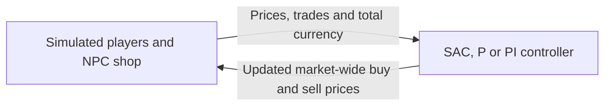
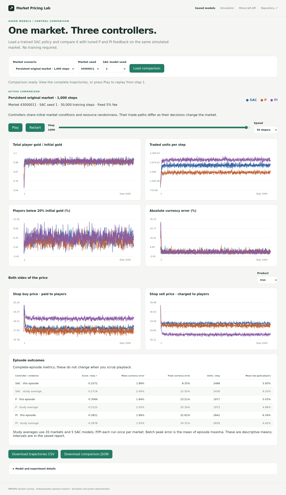

# Multi-Product Game-Market Pricing

**SAC-based pricing for a simulated game economy, with feedback and planning comparisons.**

How should a game shop price multiple goods while balancing player currency,
trading activity and price stability? An NPC (non-player character) shop trades
with simulated players; **Soft Actor-Critic (SAC)** learns its market-wide buy
and sell price adjustments.

Individual undergraduate capstone · NCKU Computer Science ·
[evanchang1217](https://github.com/evanchang1217). Original capstone: **2nd among
87 projects** (author-reported). [Poster and project history](docs/project.md#original-poster).

[Demo](docs/demo.md) · [Results](results/main/) · [Methods](docs/methodology.md) ·
[Reproduction](docs/experiments.md)



<details>
<summary>Preview the saved-policy demo</summary>



Single-market illustration; study tables summarize multiple markets and policies.

</details>

## Design and implementation

- **Market formulation:** modeled player budgets, inventories and resource supply,
  with shared prices controlled from aggregate market observations.
- **Reward design:** combined trading targets, currency tracking and price
  stability; tested the revised objective in an equal-budget ablation.
- **Policy inputs:** re-expressed cumulative accounting totals relative to current
  player money and tested the representation across market conditions.
- **Working system:** implemented SAC training/evaluation and a Django demo with
  policy playback, price trajectories and downloadable data.

<details>
<summary>Controllers: SAC, P, PI and online planning</summary>

| Method | How it chooses prices |
| --- | --- |
| SAC — Soft Actor-Critic | Learns continuous price changes from simulated interactions. |
| P — proportional feedback | Responds to how far total player currency is from its target. |
| PI — proportional–integral feedback | Adds accumulated past currency error to the P response. |
| Online planner | Forecasts outcomes with a market model and searches for prices. |

P/PI rules and SAC weights are fixed during evaluation. Planning is a separate follow-up.

</details>

## Main result: original market

Five policies per SAC condition train for **30,000 interactions each**. Feedback
is selected from **36 candidates** on validation markets. Testing uses **40
held-out markets**, each with 200 players and three goods.

| Method | Common score ↑ | Currency error ↓ | Units traded | Sell-price change ↓ |
| --- | ---: | ---: | ---: | ---: |
| Feedback, validation-tuned | −36.01 | 3.39% | 183,370 | 2.15% |
| SAC, default market training | −30.70 | 2.91% | 227,090 | 1.40% |
| SAC, varied player-response training | −34.54 | 3.52% | 257,145 | 1.18% |

The common score penalizes trading, currency and price-change deviations.
Default-trained SAC exceeds tuned feedback by **+5.30** (exploratory 95% interval
**[3.88, 6.62]**). Its currency-error difference interval includes zero.
[Settings, scenarios and paired results](results/main/).

A supplementary five-seed comparison at the same **30,000-interaction budget**
tests TD3, PPO, discretized DQN and a second SAC implementation on 20 markets.
Our SAC implementation has the highest mean score in the default and reduced-supply
cases; PI leads when players respond less strongly to prices.
[RL baseline comparison, settings and intervals](results/rl-baselines/).

### Reward-design ablation: a separate 10k-budget comparison

At **10,000 training interactions per policy**, revised SAC reduces mean currency
error from **44.74% to 4.96%** versus **SAC with the legacy reward**: an **88.9%
relative reduction**, retaining **96.3% of legacy SAC's traded units**. This is a
reward-design comparison between two SAC variants.
[Ablation table and settings](results/main/#reward-design-ablation).

## Follow-up: policy inputs and planning costs

A separate two-good economy tests persistent inventory, shared production and
changing demand. Its reward differs from the original market's.

- **Policy inputs:** the revised representation improves reward over the original
  SAC inputs by **+0.263** across five paired training seeds (exploratory 95%
  interval **[0.091, 0.493]**). [Representation comparison](results/limitations/).
- **Planning:** SAC beats PI in the default case and a limited-budget planner in
  both cases. The strongest planner remains competitive; PI and strong planning
  have better mean reward when demand and production assumptions change together.
  PI is faster online; SAC requires offline training.
  [Comparisons, intervals and costs](results/planning/).

Results concern synthetic markets and chosen control targets. Inventory-sensitive
buying can reverse the SAC/P/PI ranking; scarce-production transfer remains difficult.
[Behavioral results and research scope](results/limitations/).

## Run the demo

Use Python 3.10–3.12:

```bash
python -m venv .venv
source .venv/bin/activate
python -m pip install torch==2.6.0 --index-url https://download.pytorch.org/whl/cpu
python -m pip install -r requirements.txt
python manage.py migrate
DEBUG=True python manage.py runserver --noreload
```

Open <http://127.0.0.1:8000/comparison/> for saved SAC/P/PI policies or
<http://127.0.0.1:8000/> to train a policy. [Demo guide](docs/demo.md).

## Verify and explore

```bash
python -m pip install -r requirements-dev.txt
python -m pytest -q
python manage.py check
```

The checkout includes result tables, figures and demo models. Full historical
evidence and the supplementary RL comparison are available in the
[evidence release](https://github.com/evanchang1217/Soft-actor-critic-dynamic-pricing/releases/tag/pricing-evidence-2026-11-11).
[Archive access and verification](docs/experiments.md#full-evidence-archive).
Save new runs and restored data under ignored `runs/`.

[Documentation and architecture](docs/README.md) · [Project history](docs/project.md)
