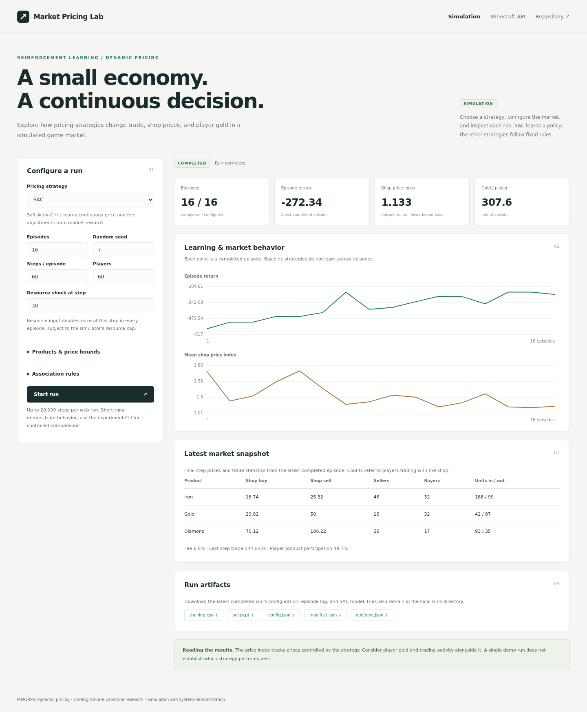
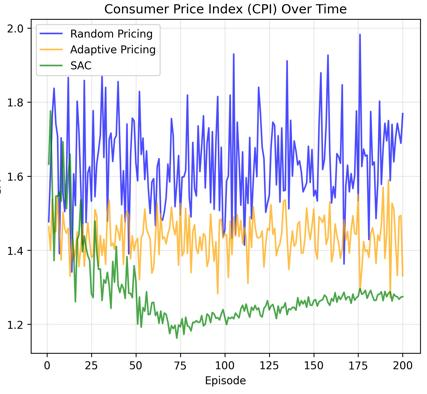
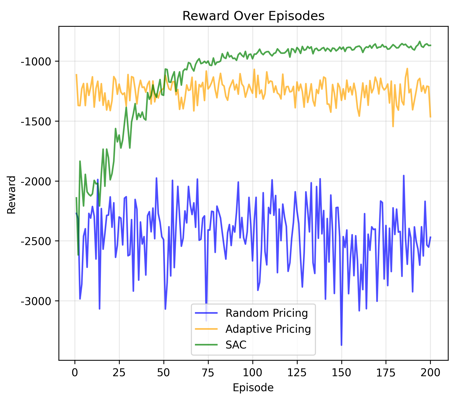

# Reinforcement Learning for MMORPG Dynamic Pricing

**NCKU CS undergraduate capstone · 2nd place among 87 projects**

This project studies how NPC shops can adjust multiple prices in a simulated game economy. It compares **Soft Actor-Critic (SAC)** with simple control policies and examines the resulting **trade activity, shop prices, and player currency** under an explicit reward.

The repository provides a shared research implementation, independent experiment tools, and an interactive Django demo. An optional Minecraft adapter reads market/player status through the original custom API.

[Research findings](#research-findings) · [Run experiments](#experiments) · [Try the demo](#interactive-demo) · [Methodology](docs/methodology.md) · [Project history](docs/project-history.md) · [Original poster](Poster/%E8%B3%87%E8%A8%8A115%E5%B0%88%E9%A1%8C%E6%B5%B7%E5%A0%B1.pdf)

## Research question and implementation scope

**Does learned pricing add value over useful simple rules, and what does the chosen reward actually optimize?**

The original capstone explored in-game inflation control. The released demo supplies a heuristic simulated-player model; it does not include the original historical-data fitting pipeline. This maintenance release separates that implementation into reusable components and adds new, explicitly labeled evaluation.

The original poster credits **張凱盛**, advised by **陳朝鈞**. Original capstone evidence, the released demo, and current maintenance/re-evaluation are distinguished in [the project history](docs/project-history.md).

## Research findings

The [follow-up comparison](results/reevaluation/2026-10-28-review/) evaluates seven strategies using **five training seeds**, **ten separate validation markets**, and **twenty fresh test markets**. Simple baseline parameters are selected on validation data. Models and selected rules are frozen before testing nominal markets and four specified market shifts.

| Method | Fresh-test return: mean ± market SD | Units traded / episode |
| --- | ---: | ---: |
| Fixed | -826.46 ± 150.33 | 79,108 |
| Random | -858.24 ± 153.62 | 75,884 |
| Adaptive (gain 0.5) | -458.37 ± 22.51 | 132,749 |
| Adaptive (validation-tuned) | -424.49 ± 10.92 | 139,993 |
| Target-price rule | -334.56 ± 8.65 | 195,026 |
| SAC, fixed fee | -299.99 ± 7.86 | 225,624 |
| SAC, price + fee | -302.13 ± 6.57 | 217,548 |

SD is across the same twenty test-market units for every method, averaging trained models within each market first. Across-model variability is reported separately in the full results. These are not confidence intervals.

A useful target-price rule narrows the gap substantially. Fixed-fee SAC slightly exceeds full-control SAC in the nominal market, while full-control SAC performs better under the tested higher-response shift. These measurements do not establish a universal benefit from fee control or statistical significance.


For nominal full-control SAC, **99.898% of the realized penalty comes from trade targets**, and about **0.00285% from money changes**. The reward weights were not changed. The result primarily demonstrates control of the implemented trading objective, not validated inflation suppression. [Reward audit, market shifts, and full interpretation](results/reevaluation/2026-10-28-review/README.md).

The legacy metric named CPI is an unweighted index of NPC sell prices relative to configured lower bounds. The policy directly controls those prices. Read that index alongside currency sinks, player balances, participation, and volume. [Definitions and assumptions](docs/methodology.md).

The earlier [four-method reference run](results/reevaluation/2026-10-28-reference/) is retained as exploratory evidence. Its initial comparison motivated stronger simple controls, a fee-control ablation, and fresh reporting seeds in the follow-up. Original poster results remain separate below.

## Experiments

Use **Python 3.10–3.12**. The locally verified environment is Python 3.10/Linux with CPU PyTorch.

```bash
git clone https://github.com/evanchang1217/Soft-actor-critic-dynamic-pricing.git
cd Soft-actor-critic-dynamic-pricing
python -m venv .venv
source .venv/bin/activate
# Windows PowerShell: .venv\Scripts\Activate.ps1

python -m pip install torch==2.6.0 --index-url https://download.pytorch.org/whl/cpu
python -m pip install -r requirements.txt
```

Use `python -m pip install -r requirements-lock.txt` instead for the exact tested Linux CPU package set, including test dependencies. Other platforms may need compatible packages within `requirements.txt`.

```bash
# Short software check of baseline selection, both SAC variants, and market shifts.
python -m experiments.review --config experiments/configs/review-smoke.json --out runs/review-smoke

# Complete follow-up: train both variants, select rules, evaluate fresh markets.
python -m experiments.review --config experiments/configs/review.json --out runs/review
```

| Strategy | Behavior |
| --- | --- |
| Fixed | Keep initial prices and fee |
| Random | Uniform bounded price/fee changes |
| Adaptive | Participation feedback with the original gain |
| Tuned Adaptive | Same rule, with gain selected on validation markets |
| Target-price rule | Approach validation-selected constant prices using bounded actions |
| SAC, fixed fee | Separately trained price-only policy; no fee coordinate in actor/critics/entropy |
| SAC, price + fee | Learned price and fee adjustments |

Runs preserve configuration, source snapshot, validation trials, inference checkpoints, training logs, step/episode CSVs, reward decomposition, summaries, and PNG/SVG figures. Existing output directories are never overwritten. Short smoke runs are not performance evidence.

See [the follow-up protocol](docs/review-protocol.md) for exact controls, seed separation, checkpoint reuse, uncertainty units, and scenario definitions. The simpler original four-method runner remains available via [the experiment guide](docs/experiments.md).

## Interactive demo

```bash
cp .env.example .env
# Windows: copy .env.example .env
python manage.py migrate
python manage.py runserver --noreload
```

Open **<http://127.0.0.1:8000/>**. The demo provides four exploratory strategies (Fixed, Random, Adaptive, SAC), editable market settings, episode charts, stopping, and downloadable CSV/model/configuration files. It calls the same core as the experiment tools; use the CLI for the seven-method controlled comparison.

<a href="docs/assets/demo.png"></a>

*A short interface demonstration, separate from the research comparison. [Demo usage and runtime limits](docs/demo.md).*

The **Minecraft API** tab defaults to labeled synthetic data. Set `MINECRAFT_MODE=live` and `MINECRAFT_API_BASE_URL` in `.env` to connect the existing custom API. This adapter reads status; original automatic inference/write-back and the game plugin are separate components. [API contracts and deployment scope](docs/minecraft-api.md).

## Original capstone evidence

<p>
  
  
</p>

These are directly extracted original poster figures. The poster reports favorable SAC simulation trends, but its exact raw logs, seeds/settings, and baseline implementations were not recovered from the released demo. The new comparisons are **re-evaluations based on the demo implementation**, not exact reproductions or measurements of live-game economic effects. [Original artifact provenance](results/original/README.md).

## Code map

| Path | Purpose |
| --- | --- |
| [`rl/`](rl/) | Validated settings, Gymnasium market, SAC, training, inference artifacts |
| [`experiments/`](experiments/) | Baselines, selection, fee ablation, evaluation, reward audit, plotting |
| [`myapp/`](myapp/) | Django configuration, background runs, charts, downloads, market view |
| [`integrations/`](integrations/) | Standalone Minecraft read client and synthetic sample fixture |
| [`results/`](results/) | Original figures and separately documented new evidence |
| [`tests/`](tests/) | Environment/accounting, SAC, protocol, analysis, API, and demo checks |
| [`docs/`](docs/) | Methods, provenance, operation, validation, and interpretation |
| [`Poster/`](Poster/) | Original capstone poster |

## Validation and limitations

```bash
python -m pip install -r requirements-dev.txt
python -m pytest -q
python manage.py check
```

Tests cover accounting and bounds, actual SAC updates/checkpoints, seed separation, baseline selection, fee ablation, reward reconstruction, aggregation, and demo/API behavior. CI is configured for Python 3.10 and 3.12; local verification details are in [the validation record](docs/validation.md).

The simulator uses heuristic player behavior, aggregate partial observations, and no fitted utility/consumption model. The tested shifts are limited, and the reward's economic meaning requires care. No statistical significance, general real-player fidelity, or live-server improvement is inferred solely from these simulation results. [Full methodology](docs/methodology.md).

## References

- [Original capstone poster](Poster/%E8%B3%87%E8%A8%8A115%E5%B0%88%E9%A1%8C%E6%B5%B7%E5%A0%B1.pdf).
- Haarnoja et al., [Soft Actor-Critic](https://arxiv.org/abs/1801.01290), 2018.
- [Spinning Up: SAC](https://spinningup.openai.com/en/latest/algorithms/sac.html) and [Gymnasium](https://gymnasium.farama.org/).
