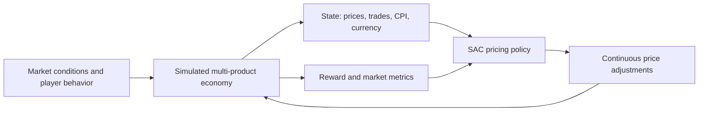
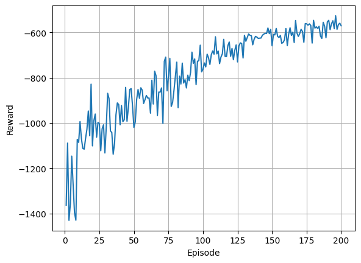

# Reinforcement Learning for Multi-Product Dynamic Pricing in an MMORPG

**NCKU Computer Science Undergraduate Capstone | 2nd place among 87 projects**

This project investigates how a **Soft Actor-Critic (SAC)** agent can adapt NPC-shop buy/sell prices to help control inflation in a multiplayer game economy, without simply eliminating trading activity. It combines a simulated market, a continuous-action pricing policy, and an interactive Django/PyTorch demonstration.

**Research themes:** reinforcement learning · environment modeling · reward design · sequential decision-making · simulation-based evaluation

> **Evidence and scope:** The original [capstone poster](Poster/%E8%B3%87%E8%A8%8A115%E5%B0%88%E9%A1%8C%E6%B5%B7%E5%A0%B1.pdf) reports comparisons between SAC, random pricing, and adaptive pricing in **simulation**. This repository exposes a local training demonstration, but does not currently package the original comparative runs, training logs, or the full historical-data analysis needed to reproduce all poster figures. We therefore do **not** claim a specific percentage improvement or measured live-server performance here.

## 1. Research question

In an MMORPG, repeated resource gathering and sales to NPC shops can inject currency into the economy. Fixed NPC prices may fail to respond to changing supply, demand, and players' gold holdings. Manually adjusting many product prices is difficult, while unconstrained automated pricing may harm trading activity.

**Can a learned policy adjust multiple buy/sell prices over time to improve price stability while preserving market participation?**

A practical challenge is that real-world player transactions are too limited for extensive exploratory RL training. The capstone therefore used a simulator-first research approach.

## 2. Overview



*Conceptual research workflow; see the linked poster for the original figures and project-level system diagram.*

## 3. Environment modeling

The capstone poster describes a simulated player market informed by historical transaction data and by models of trading preferences, including logistic regression and item co-occurrence/association patterns. Factors such as inventories, gold holdings, and price sensitivity were considered.

**What the public code implements:** The released [MultiStoreEnv in sac_component.py](myapp/sac_model/sac_component.py) models multiple players and products with stochastic resource drops, player inventories, gold balances, price/fee sensitivity, and price-dependent buying and selling. It also supports **user-configured association rules** for complementary or substitutable purchases.

**Important distinction:** The public demo does not include an end-to-end script that fits logistic regression or mines Apriori rules from the original historical transaction dataset. Those methods are documented in the capstone poster; the currently published Python environment should not be described as reproducing that historical-data pipeline.

## 4. Reinforcement learning formulation

| Element | Description |
| --- | --- |
| **State** | Shop buy/sell prices, numbers of buyers/sellers, trade volumes, currency sink, CPI, total player gold, and fee rate in the public implementation. State features are normalized for policy input. |
| **Action** | Continuous changes to product buy/sell prices, plus a shop fee adjustment in the public implementation. |
| **Reward** | A negative weighted sum of deviations in participation and traded volume, together with penalties for changes in CPI and player currency. |
| **Agent** | SAC with a Gaussian policy, twin Q-networks, replay buffer, target-network updates, and entropy regularization. |

### Why SAC?

Multi-product price control is naturally continuous and multidimensional. SAC allows the agent to learn gradual price adjustments while trading off the objective reward with policy exploration.

### Reward design

Optimizing CPI alone could produce undesirable market behavior if participation collapses. The environment instead penalizes deviations from participation and trade-volume targets alongside price and money-supply changes. The exact publicly implemented terms and their coefficients can be inspected in [the environment's step function](myapp/sac_model/sac_component.py).

These choices are **modeling assumptions**, not evidence that the reward prevents all unintended strategies. A fuller evaluation would include reward-weight sensitivity and checks for policy behavior outside the training simulator.

## 5. Experiments and findings

The [project poster](Poster/%E8%B3%87%E8%A8%8A115%E5%B0%88%E9%A1%8C%E6%B5%B7%E5%A0%B1.pdf) compares three strategies:

- **SAC**: a learned policy that adjusts multiple prices;
- **Random pricing**: a randomized pricing baseline;
- **Adaptive pricing**: a rule-based adaptive pricing baseline.

The poster's simulation plots show SAC reaching a **lower and more stable CPI range** than the displayed baselines, with favorable reward trends in the reported experiment. These are qualitative findings from the poster, **not** a claim about statistical significance or performance on a live server.

**For the original CPI and reward comparison charts:** [View the capstone poster (PDF)](Poster/%E8%B3%87%E8%A8%8A115%E5%B0%88%E9%A1%8C%E6%B5%B7%E5%A0%B1.pdf).

### Local training visualization



*Example SAC reward image already included in the repository. This is **not** the three-policy reward comparison from the capstone poster and should not be used as a substitute for it.*

**Reproducibility note:** The public repository does not yet provide the exact seeds, saved experiment configurations, raw output files, and baseline implementations necessary to independently regenerate the poster comparisons. Quantitative claims should be made only after those records are available and verified.

## 6. Project deployment and demonstration

The overall capstone project also included an automated NPC price-update workflow connected to a live Minecraft-based game server, as illustrated in the poster. **This is a project-level outcome, not a claim that every deployment component was independently implemented by the author of this repository.**

The public repository provides a Django interface for configuring SAC training and viewing training status. The optional server-status page requires a **separate local market API**; launching Django alone does not start a Minecraft server.

## 7. Code map

| Path | Role |
| --- | --- |
| [myapp/sac_model/sac_component.py](myapp/sac_model/sac_component.py) | Multi-product simulated market, reward function, SAC components, and training loop |
| [myapp/tasks.py](myapp/tasks.py) | Starts local background training and tracks progress |
| [myapp/views.py](myapp/views.py) | Django training configuration and status endpoints |
| [myapp/templates/](myapp/templates/) | Training forms, dashboard, and optional server status page |
| [statics/](statics/) | Static resources and a stored reward plot |
| [Poster/](Poster/) | Original undergraduate project poster |

## 8. Run the local demo

**Requirements:** Python and pip. Dependency ranges are given in [requirements.txt](requirements.txt); an exact version-locked reproduction environment has not yet been published.

```bash
git clone https://github.com/evanchang1217/Soft-actor-critic-dynamic-pricing.git
cd Soft-actor-critic-dynamic-pricing
python -m venv .venv
source .venv/bin/activate  # Windows PowerShell: .venv\Scripts\Activate.ps1
pip install -r requirements.txt
cp .env.example .env       # On Windows, copy the file manually
python manage.py migrate
python manage.py runserver
```

Edit `.env` to use your own local `SECRET_KEY`, then visit:

- Training page: `http://127.0.0.1:8000/`
- Training alias: `http://127.0.0.1:8000/start_training/`
- Training status: `http://127.0.0.1:8000/training_status_api/`
- Optional server-status page: `http://127.0.0.1:8000/server_status/` (needs separate local API at `127.0.0.1:4567`)

The training loop can save a plot to `statics/images/sac_reward.png`. Running this demo does **not** automatically reproduce the comparative curves shown in the poster. The commands above describe the existing project entry point and have not been validated here on a clean machine.

## 9. Limitations and next steps

1. **Simulator fidelity:** Simulated players may not react like real people once NPC-shop prices change.
2. **Reward sensitivity:** The balance between inflation control and trading volume deserves ablation and sensitivity analysis.
3. **Experimental reproducibility:** Saved baselines, seeds, raw data, and exact hyperparameters are needed for a stronger quantitative comparison.
4. **Simulation versus deployment:** A deployed price-update workflow does not by itself establish the size of any improvement observed in a live game.
5. **Research-code alignment:** Publishing the historical-data preprocessing and fitted behavior models used in the original capstone, if available and permissible, would better connect the public demo to the poster.

## Recognition and references

- National Cheng Kung University, Department of Computer Science and Information Engineering — undergraduate capstone competition, **2nd out of 87 projects**.
- [Original research poster](Poster/%E8%B3%87%E8%A8%8A115%E5%B0%88%E9%A1%8C%E6%B5%B7%E5%A0%B1.pdf).
- Haarnoja et al., [Soft Actor-Critic: Off-Policy Maximum Entropy Deep Reinforcement Learning with a Stochastic Actor](https://arxiv.org/abs/1801.01290) (2018).
