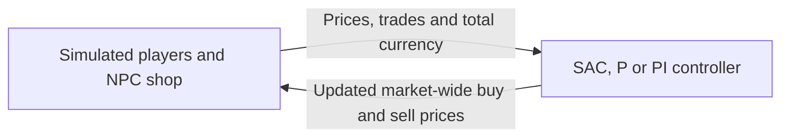

# Multi-Product Game-Market Pricing

**Learning and evaluating market-wide prices for a simulated game shop.**

Individual undergraduate capstone · NCKU Computer Science · 2nd among 87 projects
(author-reported). The award concerns the original capstone; the experiments
below include later follow-up work.

Author: [evanchang1217](https://github.com/evanchang1217) ·
[Original capstone poster](Poster/capstone-poster.pdf) · [Authorship](docs/project.md#authorship)

An NPC (non-player character) shop trades with simulated players. Its controller
changes market-wide prices to track a currency target, support trading and limit
price changes. When does learning help, and when does feedback or planning work better?

[Demo](docs/demo.md) · [Main result](results/main/) ·
[Limitations](results/limitations/) · [Planning](results/planning/) ·
[Reproduction](docs/experiments.md)



<details>
<summary>Preview the saved-policy demo</summary>


Single-market illustration; study tables summarize multiple markets and policies.

</details>

## What I designed and implemented

- **Market formulation:** modeled player budgets, inventories and resource supply;
  controllers observe aggregate prices, trades and currency and set shared prices.
- **Control objective:** a reward that combines trading targets, currency tracking
  and price stability. At equal 10k interaction budgets, the revised objective
  reduced currency error by **88.9% versus legacy SAC** while retaining **96.3%
  of traded units**. [Objective study](results/main/).
- **Policy inputs:** tested a revised representation of growing accounting totals
  and evaluated its benefits and transfer failures against feedback and planning.
- **Working system:** built the SAC training/evaluation core and Django demo with
  policy playback, price trajectories and downloadable data.

SAC is an established algorithm; the contributions are market/control formulation,
implementation and empirical analysis. Player behavior is synthetic and uncalibrated;
real-game inflation control and welfare are unproven. [Methods](docs/methodology.md).

## How the controllers differ

| Method | How it chooses prices |
| --- | --- |
| SAC — Soft Actor-Critic | Learns continuous price changes from simulated interactions. |
| P — proportional feedback | Responds to how far total player currency is from its target. |
| PI — proportional–integral feedback | Adds accumulated past currency error to the P response. |
| Online planner | Forecasts outcomes with a market model and searches for prices. |

P/PI rules and SAC weights are fixed during evaluation. Planners appear in the follow-up.

## Main result: original market

Five policies per SAC condition trained for 30,000 interactions each. A feedback
controller was selected from 36 candidates on separate validation markets;
evaluation used 40 held-out markets, each with 200 players and three goods.

| Method | Common score ↑ | Currency error ↓ | Units traded | Sell-price change ↓ |
| --- | ---: | ---: | ---: | ---: |
| Feedback, validation-tuned | −36.01 | 3.39% | 183,370 | 2.15% |
| SAC, default market training | −30.70 | 2.91% | 227,090 | 1.40% |
| SAC, varied player-response training | −34.54 | 3.52% | 257,145 | 1.18% |

Higher scores are better; these negative scores penalize deviations from the
chosen trading, currency and price-change targets. Default-trained SAC improves
the score over feedback by **+5.30**, with an exploratory 95% interval of
**[3.88, 6.62]**. Its currency-error difference interval includes zero.
[Settings, scenarios and paired results](results/main/).

**Boundary:** when buying becomes less likely as players accumulate inventory,
SAC loses its advantage over P/PI at the tested budget.
[Behavioral and mechanism results](results/limitations/).

## Follow-up: policy inputs and planning costs

A separate two-good economy has persistent inventories, shared production and
changing demand. Its different reward makes scores incomparable with the table above.

- **Policy inputs:** re-expressing accounting totals relative to current player
  money improves later reward by **+0.263** across five new paired training seeds
  (exploratory 95% interval **[0.091, 0.493]**). Transfer to scarce-production
  markets still fails. [Results and limits](results/limitations/).
- **Planning:** SAC beats PI in the default case and a limited-budget planner in
  both tested cases. Superiority over the strongest planner is **not established**.
  Changing demand and production assumptions together favors PI and strong
  planning in mean reward. PI is faster online; SAC requires offline training.
  [Comparisons, intervals and costs](results/planning/).

## Run the demo

Use Python 3.10–3.12:

```bash
python -m venv .venv
source .venv/bin/activate
python -m pip install torch==2.6.0 --index-url https://download.pytorch.org/whl/cpu
python -m pip install -r requirements.txt
python manage.py migrate
DEBUG=True python manage.py runserver --noreload
```

Open <http://127.0.0.1:8000/comparison/> to compare saved policies or
<http://127.0.0.1:8000/> to train one. The demo uses the original/behavioral
market. [Demo guide](docs/demo.md).

## Verify and explore

```bash
python -m pip install -r requirements-dev.txt
python -m pytest -q
python manage.py check
```

The checkout includes key result tables, figures and demo models. Complete
historical verification requires a checksum-verified evidence archive, currently
**local and not publicly downloadable**. [Archive access and verification](docs/experiments.md#full-evidence-archive).
New runs and restored data belong in ignored `runs/`.

| Directory | Contents |
| --- | --- |
| `rl/` | Original market, SAC and training |
| `experiments/` | Study runners, shared markets and controllers |
| `myapp/`, `project/`, `statics/` | Django demo |
| `results/` | Key results and demo models |
| `docs/`, `scripts/`, `tests/` | Methods, reproduction and checks |
| `integrations/`, `Poster/` | Minecraft status client and original poster |

[Documentation and architecture](docs/README.md) ·
[Authorship and AI-assisted follow-up](docs/project.md#authorship)
