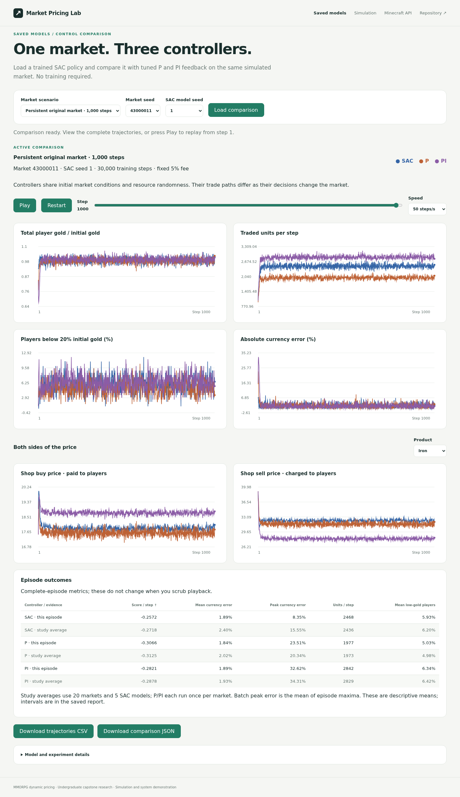
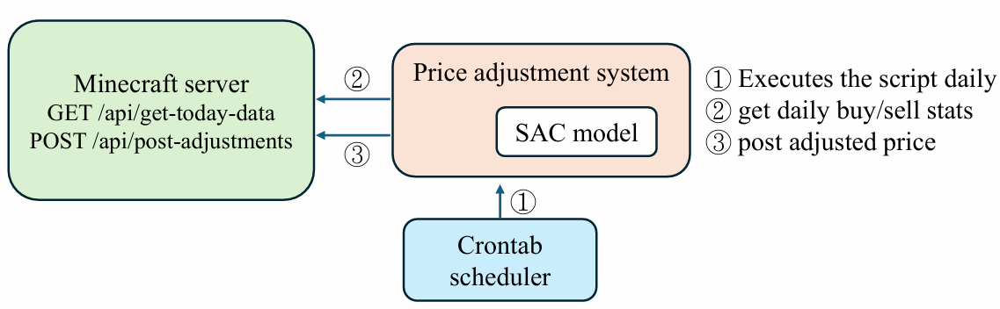

# Running the interactive demo

Install dependencies using the [root README](../README.md#run-the-demo), then run
from the repository root with the virtual environment active:

```bash
python manage.py migrate
DEBUG=True python manage.py runserver --noreload
```

Open <http://127.0.0.1:8000/comparison/> for saved models or
<http://127.0.0.1:8000/> for training. Charts and styles are local; no CDN,
Minecraft service or GPU is required. The ten required saved policies and demo
summary/validation tables remain in the checkout; the full evidence archive is
needed only for research replay.

## Compare saved SAC, P and PI controllers

Choose **Saved models** in the navigation. The page loads the behavioral audit's saved
30k SAC checkpoints and frozen P/PI parameters; it performs deterministic
inference without training.

1. Select the original 100-step market, persistent 1,000-step market, or the
   consumption/satiation market. Choose any of the study's 20 test-market seeds
   and five SAC model seeds. Defaults use the first declared seeds.
2. Load the comparison. SAC, P and PI share initial market conditions and the
   resource process; their trade paths respond to their own decisions.
3. Play, pause or scrub the trajectories. Inspect currency, volume, low balances
   and per-product buy/sell prices; switch products without rerunning inference.
4. Compare complete-episode metrics with the saved multi-seed study averages.
   Playback does not change these full-episode summaries.
5. Download the trajectories CSV or complete JSON, including model/protocol hashes
   and controller parameters.

Consumption/satiation uses SAC trained in that market and controls tuned there.
Persistent-market inference uses the original 100-step-trained policies and
original validation parameters. The single-market animation is an illustration;
use the [behavioral results](../results/limitations/) for paired
uncertainty and multi-seed conclusions. The comparison allows only the saved
study's scenarios/seeds and verifies checkpoint, protocol and implementation
hashes. Each process caches up to twelve completed comparisons. Training and
comparison reserve the same execution slot, keeping checkpoint construction from
changing an active training run's PyTorch random stream.

<details>
<summary>Preview the comparison page</summary>



</details>

## Train a new policy

The interactive demo offers **Balanced currency + trade** (default) and the
**Legacy trade-target reward**. Balanced uses the same reward coefficients as
the [balanced-control study](protocols.md#objective-design). Both objectives keep the fee
at 5% for every strategy, including Random and SAC.

The demo defaults to **10k training**. The
[five-seed 30k robustness and trade-off study](../results/main/)
is a CLI experiment. The training form starts a new policy with a 20k-step limit;
the separate **Saved models** page loads the behavioral audit checkpoints.

1. Choose SAC, Fixed, Random, or Adaptive and select a reward objective.
2. Keep the default research settings or set the seed, episodes, market steps,
   players, price ranges, and optional resource shock.
3. Start a run. SAC learns; baselines run independent simulations without learning.
4. Inspect the active run's objective, episode return, mean shop-price index,
   final gold/player, final gold deviation, traded units, and market statistics.
5. Download the latest completed run's CSV/configuration, provenance manifest, and SAC inference model. Stop retains completed episodes and writes an explicit partial outcome for SAC.

With very short SAC runs, the replay buffer may not reach the batch size and no learning occurs. The status message explicitly reports when there were no parameter updates; inspect `updates` in the CSV/outcome before interpreting the model. The saved zero-update checkpoint is available for inspection but is rejected by evaluation. Use `experiments.balanced_control` for controlled, frozen-policy comparisons.

## Research settings and metric interpretation

The initial form matches one training seed of the balanced-control study:
200 players, three default goods, 100 episodes × 100 steps, a step-50 resource
shock, hidden width/batch size 128, 1,000 warmup steps and fixed 5% fee.
Balanced coefficients are count 0.5, volume 0.5, index change 0.05 and currency
deviation 1.0. Legacy retains coefficients 1, 1, 0.5 and 0.5. The market's
initial total player gold is the currency setpoint for Balanced.

Training can take a few minutes on CPU. Smaller runs reduce warmup to at most
one quarter of their total steps and are exploratory demonstrations. Both
objectives use the same fixed-fee action convention; this legacy option does
not restore the older fee-controlling web demo. Custom market settings do not
reproduce the published experiment.

The active-run label and chart label use the saved configuration, so changing
the form does not relabel previous results. Reloading preserves the selected
objective. Downloaded configurations and SAC checkpoints record the actual
reward version/weights and fee-control setting.

**Final gold deviation** is `100 * abs(final_total_gold / initial_total_gold - 1)`.
The chart shows that end-of-episode quantity across episodes. The research
table instead reports mean absolute deviation across **all steps** of frozen
evaluation episodes. Training returns also use different scales for the two
objectives. Compare activity and currency indicators alongside the return;
a single training run does not reproduce the multi-seed held-out comparison.

## Products and relationships

Shop buy prices are paid to players, and shop sell prices are charged to them. All bounds must be positive and satisfy `buy_low < buy_high <= sell_low < sell_high`.

Optional manually configured association rules use zero-based product indices:

```json
[
  {"antecedent": [0], "consequent": 1, "type": "complementary", "confidence": 0.7},
  {"antecedent": [1], "consequent": 2, "type": "substitute", "probability": 0.5}
]
```

These rules influence sampled purchase probabilities. They are not automatically fitted or mined from historical data.

## Runtime and storage

The demo reserves one job at a time per Django process and runs it in a background thread. Use a **single local process with `--noreload`**: auto-reload interrupts jobs; multiple WSGI processes would have separate in-memory job states. This local demonstration is not a persistent multiuser job service.

The startup command sets `DEBUG=True` for local static files. It overrides an existing `DEBUG=False` setting for that command.

Limits: 1–200 episodes, 1–500 steps/episode, at most 20,000 total steps, 2–1,000 players, and 1–12 products. Use the CLI for larger research batches.

Outputs are stored in `runs/demo/<run-id>/`. Reloading the page does not erase results. The status/download interface serves the latest run in the current process; older artifacts remain on disk but are not rediscovered after a restart.

`/server_status/` is the independent optional Minecraft API page. It defaults to labeled synthetic data; see [the integration guide](demo.md#minecraft-integration) for live connections and implementation scope.


## Minecraft integration

The game integration uses a **custom HTTP API**, not Minecraft's standard server-query protocol. The plugin/server implementing those routes is an external component and is not included in this repository.

The currently runnable adapter is read-only. It preserves the two data reads from the original Django demo and moves them into [`integrations/minecraft.py`](../integrations/minecraft.py).

## Author-reported field-testing status — 2026-11-04

The author reports limited testing on a game server by the collaborating
company; detailed field measurements are currently unavailable. This account
does not independently establish the tested model revision or measured economic
effects. Quantitative comparisons released here use simulation. The public API
adapter demonstrates and tests status integration separately from that testing.

## Try it without a game server

The default `MINECRAFT_MODE=sample` reads [`market_status.json`](../integrations/fixtures/market_status.json), a synthetic fixture. Open `/server_status/`. The page explicitly labels its sample data and makes no network requests to Minecraft.

To connect your existing API, set the following in `.env`, then restart Django:

```dotenv
MINECRAFT_MODE=live
MINECRAFT_API_BASE_URL=http://127.0.0.1:4567
MINECRAFT_API_TIMEOUT=5
```

Live mode displays connection or schema errors; it never silently substitutes synthetic data. The page fetches a snapshot on load/refresh. It does not continuously poll the server.

## Existing response contracts

`GET /api/market/status`:

```json
[
  {
    "player": "NPC Shop",
    "type": "buy",
    "products": {"iron_ingot": 120, "gold_ingot": 45},
    "prices": [15, 30]
  }
]
```

`type` is `buy` or `sell` from the shop's perspective. Prices correspond to the iteration order of product keys in the API response, retaining the original demo's contract. Keep the same product/price ordering in the API implementation; a future version should use explicit product IDs and price fields rather than parallel sequences. Quantities/prices must be finite, nonnegative numbers and the sequences must have matching lengths.

`GET /api/player/status`:

```json
{"onlinePlayers": 12, "loggedInToday": 38}
```

Both fields must be nonnegative integers. HTTP and JSON failures are wrapped in `MinecraftAPIError`. The client can also be used without Django:

```python
from integrations.minecraft import MinecraftClient
status = MinecraftClient("http://127.0.0.1:4567", timeout=5).status()
print(status["players"])
```

## What the original poster describes



The poster describes a separate scheduled workflow: a daily script reads transaction statistics from `GET /api/get-today-data`, invokes SAC, then sends new prices to `POST /api/post-adjustments`.

The original daily script, write-endpoint schema, game plugin, historical preprocessing, and deployed checkpoint were not found in the published demo. The old `adjust_price_form.html` referenced a Django `/adjust_price/` route without a corresponding view or URL; that disconnected template has been removed. No new endpoint is presented as a recovered production integration.

To restore the original automated deployment, add its original scripts and document the observation mapping, product ordering, price units, action scaling, normalization, checkpoint compatibility, update schedule, and confirmed response contracts. A model trained on this revised simulator should not be assumed compatible with a historical checkpoint or the real-game state mapping.
