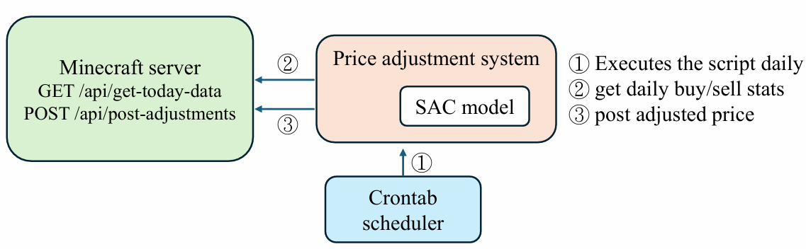

# Minecraft integration: current implementation and original deployment

The game integration uses a **custom HTTP API**, not Minecraft's standard server-query protocol. The plugin/server implementing those routes is an external component and is not included in this repository.

The currently runnable adapter is read-only. It preserves the two data reads from the original Django demo and moves them into [`integrations/minecraft.py`](../integrations/minecraft.py).

## Try it without a game server

The default `MINECRAFT_MODE=sample` reads [`market_status.json`](../integrations/fixtures/market_status.json), a synthetic fixture. Open `/server_status/`. The page explicitly labels its sample data and makes no network requests to Minecraft.

To connect your existing API, set the following in `.env`, then restart Django:

```dotenv
MINECRAFT_MODE=live
MINECRAFT_API_BASE_URL=http://127.0.0.1:4567
MINECRAFT_API_TIMEOUT=5
```

Live mode displays connection or schema errors; it never silently substitutes synthetic data. The page fetches a snapshot on load/refresh. It does not continuously poll the server.

## Existing response contracts

`GET /api/market/status`:

```json
[
  {
    "player": "NPC Shop",
    "type": "buy",
    "products": {"iron_ingot": 120, "gold_ingot": 45},
    "prices": [15, 30]
  }
]
```

`type` is `buy` or `sell` from the shop's perspective. Prices correspond to the iteration order of product keys in the API response, retaining the original demo's contract. Keep the same product/price ordering in the API implementation; a future version should use explicit product IDs and price fields rather than parallel sequences. Quantities/prices must be finite, nonnegative numbers and the sequences must have matching lengths.

`GET /api/player/status`:

```json
{"onlinePlayers": 12, "loggedInToday": 38}
```

Both fields must be nonnegative integers. HTTP and JSON failures are wrapped in `MinecraftAPIError`. The client can also be used without Django:

```python
from integrations.minecraft import MinecraftClient
status = MinecraftClient("http://127.0.0.1:4567", timeout=5).status()
print(status["players"])
```

## What the original poster describes



The poster describes a separate scheduled workflow: a daily script reads transaction statistics from `GET /api/get-today-data`, invokes SAC, then sends new prices to `POST /api/post-adjustments`.

The original daily script, write-endpoint schema, game plugin, historical preprocessing, and deployed checkpoint were not found in the published demo. The old `adjust_price_form.html` referenced a Django `/adjust_price/` route without a corresponding view or URL; that disconnected template has been removed. No new endpoint is presented as a recovered production integration.

To restore the original automated deployment, add its original scripts and document the observation mapping, product ordering, price units, action scaling, normalization, checkpoint compatibility, update schedule, and confirmed response contracts. A model trained on this revised simulator should not be assumed compatible with a historical checkpoint or the real-game state mapping.
