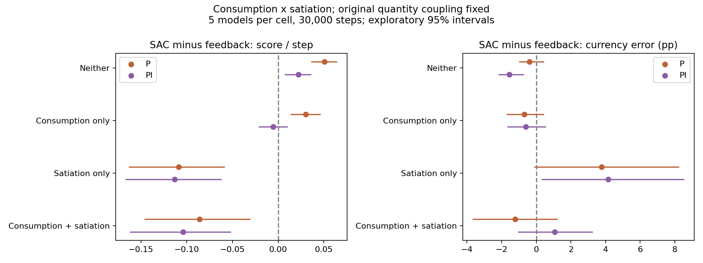

# Limitations and failure cases

## Input-representation comparison

In the default aggregate market, both SAC variants trained for **24,576
interactions per policy**, using five paired training seeds and eight evaluation
markets. The table reports mean reward in evaluation periods **97–384**.

| SAC input representation | Mean reward ↑ |
| --- | ---: |
| Original cumulative accounting inputs | −0.58530 |
| Revised inputs relative to current player money | −0.32216 |

The paired revised-minus-original difference is **+0.26313**, with an exploratory
95% interval of **[0.09067, 0.49314]**. This supports the representation correction
in the tested market; scarce-production transfer failures remain.
[Means](../confirmation/2026-11-09-stationary-retraining/summary.csv) ·
[Paired difference and interval](../confirmation/2026-11-09-stationary-retraining/contrasts.csv).

## Scope and failure cases

- **Player behavior is synthetic.** No real-player dataset was used to calibrate
  demand; results apply to the simulated environments, not proven game outcomes.
- **The behavioral assumptions matter.** When player purchasing responds to
  accumulated inventory, SAC/P/PI rankings reverse at the tested budget.
  [Behavioral results](../confirmation/2026-11-06-behavior-audit/report/summary.csv) ·
  [Independent mechanism results](../confirmation/2026-11-07-mechanism-audit/report/summary.csv).
- **Transfer is uneven.** In a separate aggregate task economy, a stationary input
  representation improves later SAC reward across five new paired seeds, but
  performance still fails in scarce-production regimes.
  [Retraining and transfer](../confirmation/2026-11-09-stationary-retraining/summary.csv).
- **Strong planning remains competitive.** Differences from the strongest planner
  have exploratory intervals crossing zero; this is neither evidence of SAC
  superiority nor proof that the methods are equivalent. [Planning comparison](../planning/).

The original and aggregate markets have different objectives and populations;
their scores are not directly comparable. Study selection was informed by
exploration, and reported intervals are exploratory and unadjusted for multiple
comparisons. [Methods and research scope](../../docs/methodology.md#research-scope).

