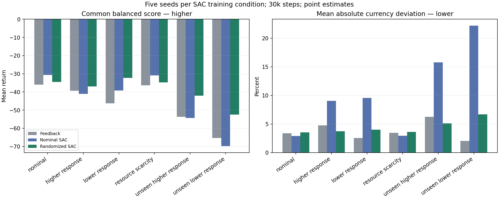

# Main experiment: original market

The NPC shop changes market-wide prices for three goods while 200 simulated
players trade. The objective combines trade, currency tracking and price stability.
The simulation is not calibrated to real players.

Five SAC policies per condition received 30,000 interactions each. A feedback
controller was chosen from 36 candidates on validation markets; each controller
was then evaluated on 40 held-out market seeds per scenario.

| Controller | Common score ↑ | Currency error ↓ | Units traded | Sell-price change ↓ |
| --- | ---: | ---: | ---: | ---: |
| Validation-selected feedback | −36.01 | 3.39% | 183,370 | 2.15% |
| SAC, default market training | −30.70 | 2.91% | 227,090 | 1.40% |
| SAC, varied player-response training | −34.54 | 3.52% | 257,145 | 1.18% |

The default-trained SAC common-score difference over feedback is **+5.30** with an
exploratory 95% interval of **[3.88, 6.62]**; the currency-error difference
interval includes zero. These scores evaluate the stated simulation objectives,
not real-player welfare.

At equal 10k budgets, the revised currency-tracking SAC objective reduced currency
error by **88.9% versus legacy SAC** while retaining **96.3% of traded units**.

[Scenario summary](../confirmation/2026-11-05-robustness/summary.csv) ·
[Paired differences](../confirmation/2026-11-05-robustness/differences.csv) ·
[Objective ablation](../reevaluation/2026-11-04-balanced-control/summary.csv) ·
[Methods](../../docs/methodology.md) · [Full evidence archive](../../docs/experiments.md#full-evidence-archive)
