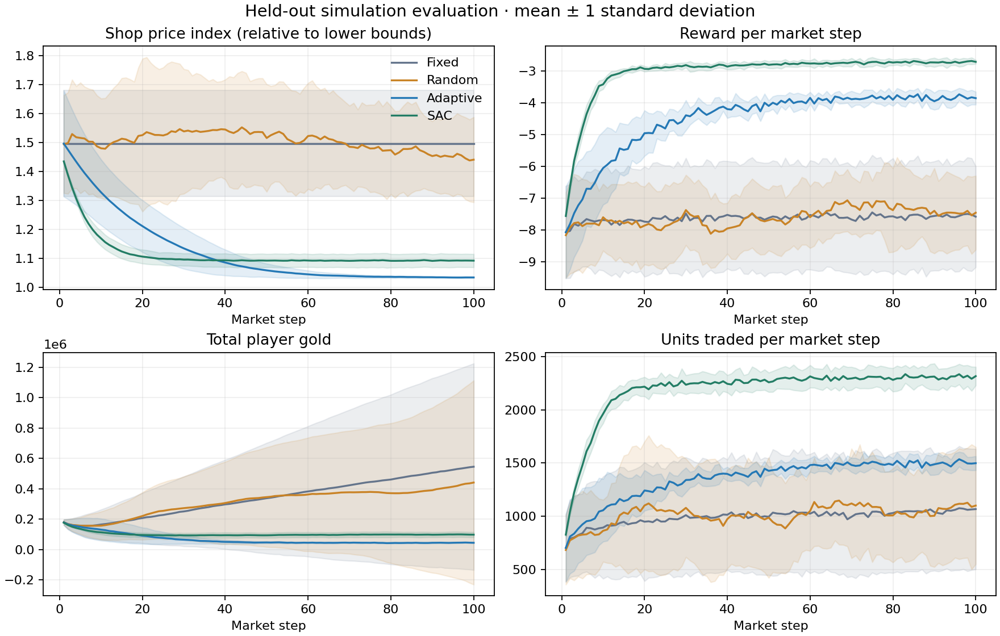
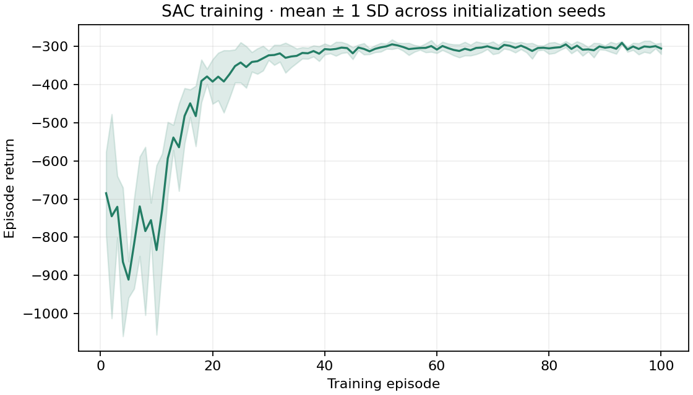

# New reference evaluation — 2026-10-28

**Re-evaluation based on the released demo implementation. This is not the experiment that produced the original capstone poster.**

This directory contains a completed run of the new `experiments/configs/default.json` protocol: 200 players, three illustrative products, 100 market steps per episode, and a 2× resource-rate shock at step 50 (subject to the resource cap).

- SAC training initialization seeds: **0, 1, 2, 3, 4**.
- Training budget: **100 episodes / 10,000 market steps per seed**, 50,000 total steps.
- Gradient updates: **9,001 per model**; see each seed's `outcome.json`.
- Held-out market seeds: **100–109**. SAC uses deterministic mean actions; evaluation performs no learning.
- Evaluation: 50 SAC rollouts and 10 per baseline, 80 total rollouts / 8,000 market steps.
- CPU PyTorch **2.6.0+cpu**, Python **3.10.12**; full versions in the preserved manifests and root dependency lock.

## Results

| Method | Episode return ↑ | Mean shop-price index | Total units traded / episode ↑ | Final player gold |
| --- | ---: | ---: | ---: | ---: |
| Fixed | -762.43 ± 167.58 | 1.496 | 99,079.50 | 545,190.94 |
| Random | -758.73 ± 65.94 | 1.505 | 101,208.80 | 441,212.08 |
| Adaptive | -448.33 ± 24.84 | 1.121 | 135,494.00 | 45,035.41 |
| SAC | -301.10 ± 8.21 | 1.115 | 218,981.34 | 98,318.55 |

Return uncertainty is sample SD. For SAC, the ten scenarios are averaged per model before computing variation across five training seeds; for baselines, variation is across ten market seeds. These are different aggregation units, not confidence intervals. See the full [summary CSV](evaluation/summary.csv), [episode CSV](evaluation/episodes.csv), and [step CSV](evaluation/steps.csv).





Under this simulator, reward, and budget, SAC achieved higher held-out return and greater trading volume than these baselines. The result does **not** establish statistical significance, an optimal reward, or effectiveness in a live game. No baseline hyperparameter sweep was performed; adaptive keeps fees fixed while SAC can adjust them.

Both SAC and Adaptive remove player currency relative to the initial 200,000 total gold. Adaptive reaches a lower price index late in the rollout, despite SAC having a slightly lower episode-average index. Lower prices and lower player currency are not independently sufficient evidence of healthy inflation control. Reward is dominated by trade-target terms and does not explicitly minimize price levels. Broader seed sets, reward/fee ablations, multiple shock scenarios, and longer convergence checks remain useful research work.

The shaded ±1 SD bands in the comparison use across-training-seed scenario means for SAC and across-scenario variation for baselines. Bands can extend beyond physically possible values; the raw trajectories still obey budget and inventory constraints.

## Reproduce or inspect

From the repository root:

```bash
# Retrain the recorded protocol in a new directory.
python -m experiments.run \
  --config results/reevaluation/2026-10-28-reference/config.json \
  --out runs/reference-reproduction

# Evaluate the included small inference checkpoints without retraining.
python -m experiments.evaluate \
  --config results/reevaluation/2026-10-28-reference/config.json \
  --checkpoints results/reevaluation/2026-10-28-reference/seed-*/policy.pt \
  --out runs/reference-checkpoint-evaluation

# Regenerate figures directly from the published CSVs.
python -m experiments.plot_results results/reevaluation/2026-10-28-reference/evaluation
```

The `*` checkpoint expansion shown above works in Bash/Zsh. In PowerShell, provide the five explicit checkpoint paths after `--checkpoints`.

## Provenance and contents

Original run command: `python -m experiments.run --config experiments/configs/default.json --out runs/reference-v1`. Files were copied from that completed run without modifying its CSVs, checkpoint metadata, or manifests. The evaluation configuration therefore retains the original local `runs/reference-v1/...` checkpoint paths and their hashes; the same checkpoint files are included here under `seed-*/policy.pt`.

The run used an uncommitted working tree based on `e092c8684b2e42dd0277d053d38824a194e51aac`, correctly marked `git_dirty: true`. Web-interface code was being edited while the suite ran, so complete Python-source digests in different manifests can differ. The **research code and experiment configurations were unchanged throughout the run**. They are preserved in `research-source.zip`, with per-file SHA-256 hashes in `research-source-hashes.json`; their modification times were checked to precede suite startup before archiving. The archive also contains the exact tested dependency lock.

The archive preserves runnable `rl/` and `experiments/` sources independently of later web-interface changes. The `.pt` files are inference checkpoints, not complete optimizer/replay snapshots. Cross-platform bitwise identity is not assumed.
