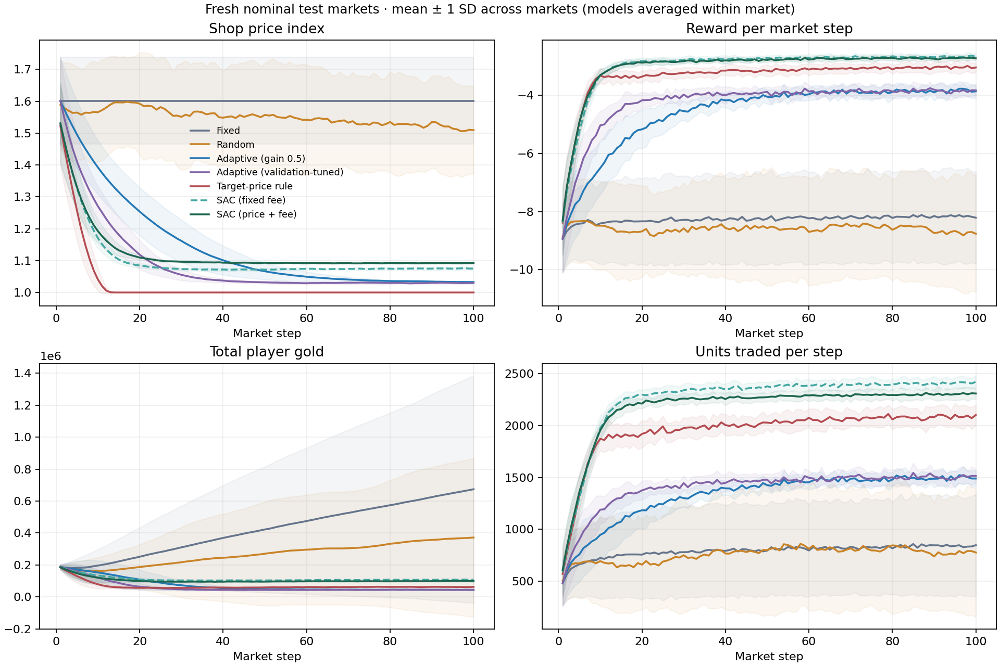
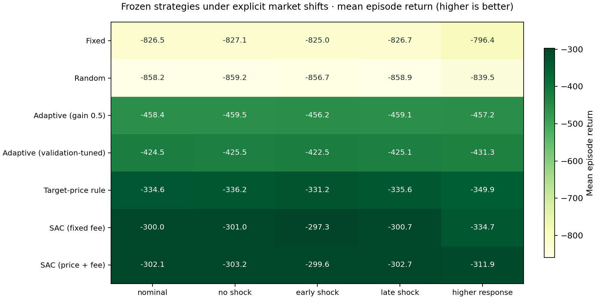

# Follow-up comparison and reward audit — 2026-10-28

This is a new evaluation derived from the released demo, following a review of the exploratory reference run. It preserves the legacy reward and adds stronger simple controls, a genuine fixed-fee SAC ablation, fresh reporting seeds, and specified market shifts. It is separate from the original poster and the first reference study.

## Protocol

- Nominal market: 200 players, three products, 100 steps, resource shock at step 50.
- Training initialization seeds: **0–4**, 100 episodes / **10,000 steps and 9,001 updates per model**.
- Five full-control SAC models are reused unchanged from the first reference run; five price-only models are newly trained with the same other settings/budget. Both model sets and their training records are included.
- Validation markets: **2000–2009**. Adaptive gain is selected from four candidates; target prices from nine buy/sell fraction pairs. All **130 validation rollouts** are saved.
- Fresh test markets: **3000–3019**, disjoint from validation/training and the previous reporting seeds.
- Seven strategies, five scenarios, **1,500 test episodes / 150,000 test steps**. Models and baseline parameters remain frozen during testing.
- The candidate grid was motivated by the earlier diagnostic. This is a transparent follow-up, not a preregistered study or independent external replication.

Validation selected **Adaptive gain 1.0**, and target-price fractions **buy 0.75 / sell 0.0**, with fee held at 0.05. Selection is based only on nominal validation returns, not the reported markets. See [all candidates](baseline_selection.json) and [validation rollouts](validation_rollouts.csv).

## Nominal test results

| Method | Return: mean ± market SD | Across-model SD | Units traded / episode | Final player gold |
| --- | ---: | ---: | ---: | ---: |
| Fixed | -826.46 ± 150.33 | — | 79,108 | 674,375 |
| Random | -858.24 ± 153.62 | — | 75,884 | 372,003 |
| Adaptive (gain 0.5) | -458.37 ± 22.51 | — | 132,749 | 44,207 |
| Adaptive (validation-tuned) | -424.49 ± 10.92 | — | 139,993 | 44,836 |
| Target-price rule | -334.56 ± 8.65 | — | 195,026 | 63,132 |
| SAC, fixed fee | -299.99 ± 7.86 | 5.12 | 225,624 | 108,142 |
| SAC, price + fee | -302.13 ± 6.57 | 8.71 | 217,548 | 99,708 |

Return is higher-is-better under the recorded legacy reward. Main-table SD uses the same test-market unit for all strategies: trained models are averaged within each market, then SD is computed across twenty markets. Across-model SD separately averages the twenty markets within each of five models. These are standard deviations, not confidence intervals or significance tests. Model averaging is statistical reporting, not an ensemble policy executing averaged actions.

The archived summary uses `0.0` as a placeholder for baseline model SD, which cannot be estimated because baselines have no trained models. A later code audit changed unavailable SDs to null or blank in newly generated results; this archive retains its original format.



The useful target-price rule substantially narrows the gap relative to the original Adaptive baseline. The two SAC variants have higher mean nominal return than that rule in this protocol. Fixed-fee SAC has a slightly higher nominal mean than full-control SAC, so these data do not support a blanket claim that adjusting fees improves performance. No significance test was performed, and the baseline grid is not an exhaustive optimization.

Both learned variants reduce player money from the initial 200,000 total gold. The target-price rule moves shop sell prices to their configured lower bounds, but a low controlled shop-price index is not independently evidence of healthy inflation control. The comparison supports conclusions about the implemented control objective, not real-player welfare or real-game economic stability.

## Specified market shifts

| Method | nominal | no shock | early shock | late shock | higher response |
| --- | ---: | ---: | ---: | ---: | ---: |
| Fixed | -826.46 | -827.07 | -824.99 | -826.65 | -796.44 |
| Random | -858.24 | -859.20 | -856.69 | -858.88 | -839.48 |
| Adaptive (gain 0.5) | -458.37 | -459.53 | -456.21 | -459.13 | -457.25 |
| Adaptive (validation-tuned) | -424.49 | -425.48 | -422.48 | -425.09 | -431.26 |
| Target-price rule | -334.56 | -336.17 | -331.24 | -335.61 | -349.86 |
| SAC, fixed fee | -299.99 | -301.05 | -297.31 | -300.68 | -334.75 |
| SAC, price + fee | -302.13 | -303.20 | -299.58 | -302.66 | -311.93 |



All strategies use the same test seeds within each scenario. The no/early/late shock cases change only the timing of the resource multiplier. The higher-response case changes the simulated participation multiplier range from [0.7, 1.3] to [0.9, 1.5]. Nothing is retrained or reselected for shifted markets.

Full-control SAC has a higher mean return than the fixed-fee variant in the higher-response case (-311.93 versus -334.75), while the nominal/timing cases favor the fixed-fee variant slightly. Fee-control value is therefore scenario-dependent in these measurements. The tested resource-timing changes produce relatively small differences; this is not a broad robustness guarantee. These limited shifts do not validate the heuristic player model against real data.

## What drives the reward?

| Method | Trade-target share | Price-change share | Money-change share |
| --- | ---: | ---: | ---: |
| Fixed | 99.9994% | 0.0000% | 0.00060% |
| Random | 99.9199% | 0.0790% | 0.00102% |
| Adaptive (gain 0.5) | 99.9493% | 0.0485% | 0.00223% |
| Adaptive (validation-tuned) | 99.9392% | 0.0581% | 0.00266% |
| Target-price rule | 99.9285% | 0.0684% | 0.00314% |
| SAC, fixed fee | 99.8933% | 0.1040% | 0.00267% |
| SAC, price + fee | 99.8976% | 0.0996% | 0.00285% |

Shares are calculated from pooled realized weighted penalties within each method/scenario. Every recorded reward is checked against the sum of configured component losses. Detailed means and shares are in [reward_components.csv](reward_components.csv).

For full-control SAC in nominal markets, trade targets account for about **99.898%** of the penalty; the money-change term contributes about **0.00285%**. The objective is overwhelmingly a trade-target objective in this setting. No reward coefficients were modified to produce this comparison. A reward-normalization/sensitivity study would be separate future work, not a retroactive change to the capstone objective.

## Reproduce

From the repository root, evaluate both included model sets without retraining:

```bash
python -m experiments.review \
  --config results/reevaluation/2026-10-28-review/config.json \
  --full-checkpoints results/reevaluation/2026-10-28-review/models/sac/seed-*/policy.pt \
  --fixed-fee-checkpoints results/reevaluation/2026-10-28-review/models/sac_fixed_fee/seed-*/policy.pt \
  --out runs/review-replay
```

For a fully retrained run, omit both checkpoint options. Wildcards above are for Bash/Zsh; PowerShell users should supply explicit paths. Saved checkpoints are inference artifacts, not replay/optimizer snapshots for exact training resumption.

Regenerate plots or audit the compressed published data without training:

```bash
python -m experiments.plot_review results/reevaluation/2026-10-28-review
python -m experiments.analyze_reward results/reevaluation/2026-10-28-review --out runs/review-reward-audit
```

`steps.csv.gz` contains all 150,000 raw test steps. The plotting/audit commands read it transparently; `step-log.json` records the compressed and uncompressed hashes. Episode-level data remain directly readable in [episodes.csv](episodes.csv), with all summary columns in [summary.csv](summary.csv).

Verification reran the complete protocol using both published checkpoint sets. Validation selection/trials, episode/summary/reward-component CSVs, and all 150,000 raw test steps matched exactly. Plotting and reward analysis from the compressed publication also reproduced identical PNGs and component results.

## Provenance and limitations

Original command: `python -m experiments.review --config experiments/configs/review.json --full-checkpoints results/reevaluation/2026-10-28-reference/seed-*/policy.pt --out runs/review-v2`.

The source archive and per-file hashes were captured before selection/training, and research-source hashes were checked again at completion. This was an uncommitted working tree, correctly recorded as dirty; the source archive preserves the actual implementation and lockfile. The five reused full-control models keep their original training manifests, while `models.json` records all input/stored checkpoint paths and hashes. Paths in manifests refer to the original local run; all needed models are copied into this result directory.

Publishing copied the completed run and gzip-compressed only its raw step log. No episode results, selections, summaries, weights, source snapshots, or manifests were rewritten. Original capstone figures and the first reference run remain unchanged. CPU Python/package details are recorded in the manifests; cross-platform bitwise identity is not assumed.

The simulator is partially observed and heuristic, has no fitted consumption/utility model, and the legacy reward has weak realized currency influence. Five training seeds, twenty reporting markets, and five designed scenarios do not establish optimality, statistical significance, simulator fidelity, or a live-server effect. See [the exact follow-up design](../../../docs/review-protocol.md) and [modeling assumptions](../../../docs/methodology.md).
